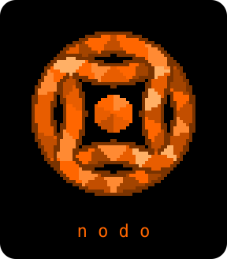
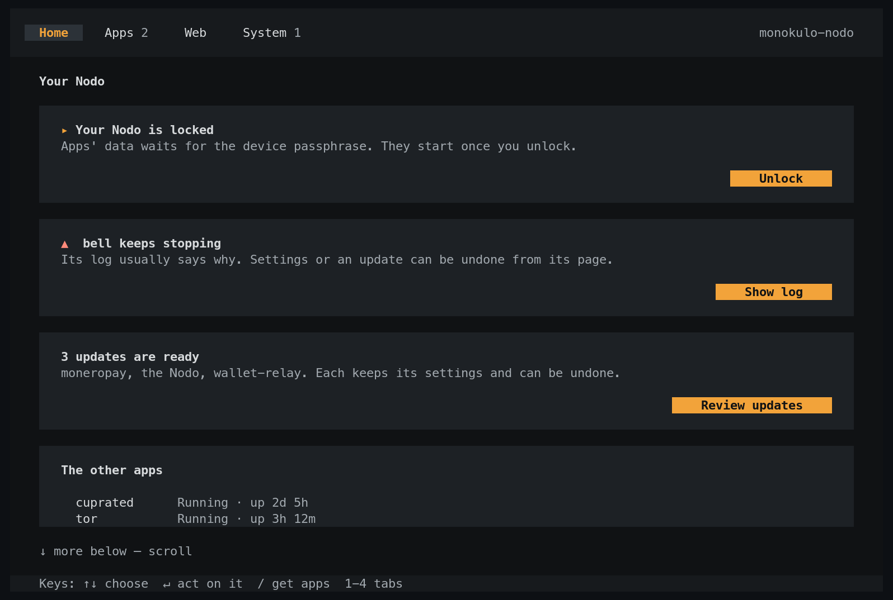
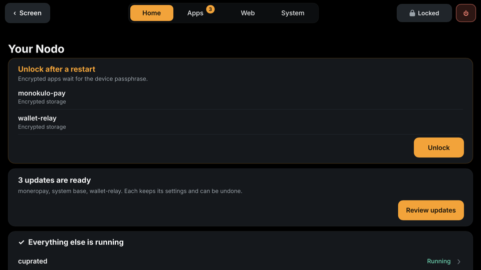

<p align="center">
  
</p>

<h1 align="center">monokulo-nodo</h1>

<p align="center">
  <strong>A from-scratch Monero appliance for the FriendlyElec NanoPC-T6N.</strong><br>
  Void Linux and runit, one Rust codebase, and signed xbps packages from feeds you choose.<br>
  A Monero node by default, with Monokulo, the light wallet server and more one install away.
</p>

<p align="center">
  <a href="https://github.com/OceanEilonwy/monokulo-nodo/actions/workflows/crates.yml"></a>
  <a href="https://github.com/OceanEilonwy/monokulo-nodo/actions/workflows/system.yml"></a>
  <a href="https://github.com/OceanEilonwy/monokulo-nodo/actions/workflows/feed.yml"></a>
  <a href="LICENSE"></a>
</p>

<p align="center">
  <a href="docs/ARCHITECTURE.md"><b>Architecture</b></a> ·
  <a href="docs/FEED.md"><b>App feed</b></a> ·
  <a href="docs/SCREEN.md"><b>Screen</b></a> ·
  <a href="docs/UPDATES.md"><b>Updates</b></a> ·
  <a href="#building"><b>Building</b></a>
</p>

> **Status: early development. It has not yet been proven on real hardware. Do not rely on it for funds.**

## Why monokulo-nodo

- **A node first.** `cuprated` runs by default, with `monerod` as an alternative. Its RPC is restricted and stays on loopback; only P2P is open to the network.
- **Every service in its own box.** Each one gets its own user, a bubblewrap sandbox, per-user nftables rules and a Landlock and seccomp layer, all generated from its manifest. Packages never write system configuration.
- **Apps from signed feeds.** The [project's feed](docs/FEED.md) at https://nodo.monokulo.com carries Monokulo, the Bell, the push relay, the light wallet server and Kringle. You can add feeds of your own; every package is checked against its feed's pinned key, and new permissions wait for you.
- **Updates that can be undone.** The base system arrives in tested, signed snapshots, never straight from Void's rolling `current`, with A/B rollback, opt-in auto-updates and backups to USB. See [updates, rollback, health and backups](docs/UPDATES.md).
- **Its own screen.** The T6N's touchscreen shows the panels packages offer, OLED dark, arranged as you like. A terminal UI covers the rest: apps, hosting, network and system.

<table>
  <tr>
    <td width="45%"></td>
    <td width="55%"></td>
  </tr>
  <tr>
    <td align="center">Home in the terminal UI, which opens when you log in over SSH</td>
    <td align="center">Home on the T6N's touchscreen</td>
  </tr>
</table>

## Building

Docker is the only requirement for images. KVM speeds up service tests on x86_64.

```sh
scripts/test.sh fast                      # static checks, a few seconds
scripts/test.sh vm                        # changed packages in a running KVM VM
scripts/test.sh full                      # aarch64 image, cold boot, reboot and size checks
tests/tui-e2e.sh --fresh device           # the real TUI and helper in a clean KVM VM, through a terminal
scripts/build-packages.sh aarch64 cuprated cuprated-service nodo-base linux-nanopc-t6n
scripts/build-image.sh nanopc-t6n ~/.ssh/id_ed25519.pub
# The same image on the mainline longterm kernel, see docs/MAINLINE_KERNEL.md
scripts/build-packages.sh aarch64 linux-mainline-rk3588
scripts/build-image.sh nanopc-t6n-mainline ~/.ssh/id_ed25519.pub
scripts/build-image.sh qemu-virt-mainline build/test-key.pub && tests/qemu-boot-test.sh qemu-virt-mainline
tests/inspect-t6n-mainline.sh out/images/nanopc-t6n-mainline/monokulo-nanopc-t6n-mainline-sd.img \
	out/images/nanopc-t6n/monokulo-nanopc-t6n-sd.img
```

- [Hardware test](docs/HARDWARE_TEST.md), [mainline kernel notes](docs/MAINLINE_KERNEL.md) and [TUI design](docs/design/tui/)

## License

GPL-3.0-or-later. Packaged software, such as Cuprate, keeps its own license.
